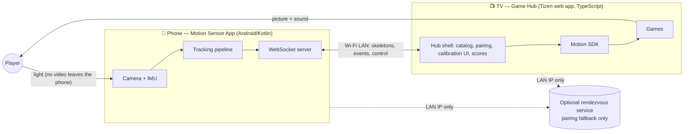
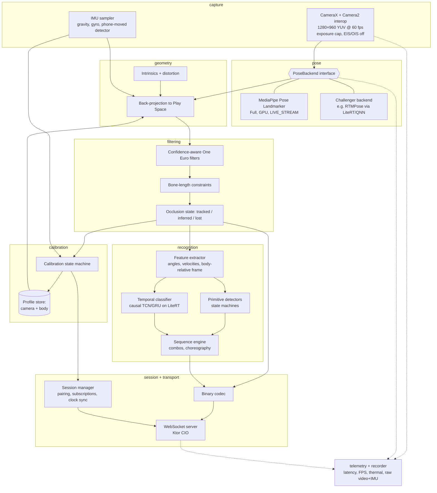
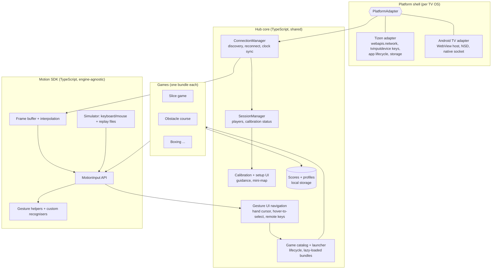
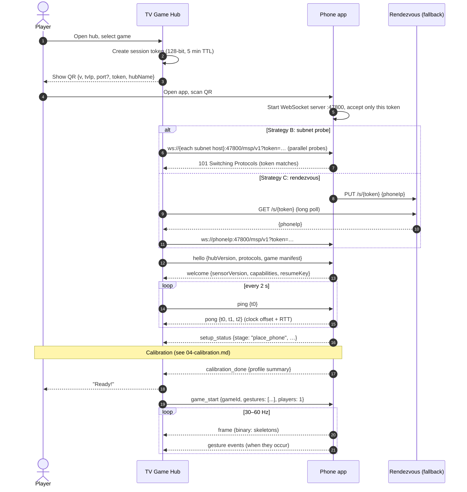
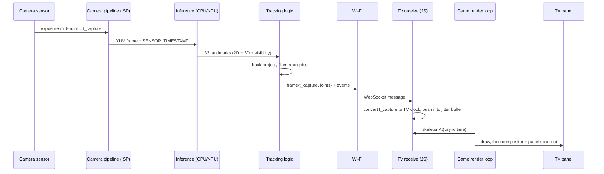

# 02 — System Architecture

Covers deliverables **2** (architecture), part of **8** (pairing/session flows) and **13** (technology stack).

---

## 1. Design principles

1. **The phone is a sensor, the TV is a console.** All vision, calibration and gesture recognition run on the phone. The TV never sees pixels, only skeletons and events.
2. **Games never talk to the phone directly.** They use a stable SDK on the TV. The wire protocol, the pose model and the phone OS can all change underneath without touching game code.
3. **Model-agnostic tracking.** The pose network sits behind a `PoseBackend` interface and emits a canonical joint set. Swapping MediaPipe for another model is a backend change, not a protocol change.
4. **Platform-agnostic TV hub.** Hub and games are TypeScript web code. Android TV/Google TV (first), Tizen (second) and webOS differ only in a thin platform shell.
5. **Record and replay everything.** Raw camera + IMU recordings on the phone, and tracking-stream recordings on the TV, are first-class. They drive model selection, regression tests and game development without a phone.
6. **No cloud in the real-time path.** At most a rendezvous service for pairing fallback (exchanging LAN addresses only).

---

## 2. System context



---

## 3. Component 1: Phone motion sensor app



**Threading model.** Four lanes, connected by bounded single-slot queues ("latest wins") so a slow stage drops frames instead of building latency:

| Lane | Work | Budget per frame at 60 fps |
|---|---|---|
| Camera callback | Timestamp, hand the image to inference, never block | < 1 ms |
| Inference | Pose model (GPU or NPU delegate) | ≤ 12 ms |
| Tracking logic | Projection, filters, features, recognisers, encoding | ≤ 2 ms |
| Network I/O | Coroutine-based WebSocket writes, ping/pong | async |

Kotlin code in the hot path uses preallocated arrays and object pools to avoid garbage-collector pauses.

**Phone UI.** The rear (main) camera faces the player, so the phone screen faces away from them. The phone UI is therefore minimal: pairing (QR scan), a "point me at the player" preview used while placing the tripod, then a dimmed status screen. All player-facing guidance is shown on the TV. Dimming the screen during play is a meaningful power and heat saving.

**Lifecycle.** Foreground activity with the screen kept on (Android does not allow background camera use). Handle interruptions (calls, notifications, thermal events) by pausing the stream with an explicit `sensor_paused` message so the TV can pause the game.

---

## 4. Component 2: TV Game Hub



**Single app, games as plugins.** On Tizen, the hub and all games ship as one packaged web app (`.wgt`), and each game is a lazily loaded ES module bundle implementing a lifecycle contract. Separate apps per game would make the phone re-pair at every switch. Iframes cost memory on TV SoCs.

```ts
// Contract every game implements (illustrative, not final code)
interface MotionGame {
  readonly manifest: {
    id: string;                     // "com.motionhub.slice"
    minPlayers: 1; maxPlayers: 1 | 2;
    requiredGestures: GestureId[];  // tells the phone which recognisers to enable
    usesSkeleton: boolean;          // continuous joints vs events only
  };
  load(ctx: GameContext): Promise<void>;   // assets, renderer
  start(): void;
  pause(reason: PauseReason): void;        // sensor lost, player left, remote key
  resume(): void;
  dispose(): void;
}
```

**Menu navigation.** Every screen must be operable both with the TV remote and by gesture (Kinect-style hand cursor with hover-to-select). The remote is the reliable fallback while the player is out of frame or not yet calibrated.

---

## 5. Component 3: Game development framework

### 5.1 Engine evaluation for Samsung Tizen TVs

| Option | Runs on Tizen TV? | Performance on TV SoCs | Dev productivity | Verdict |
|---|---|---|---|---|
| **HTML5 Canvas 2D** | Yes, all models | Adequate for simple 2D, CPU-bound, weak with many sprites | High | Fallback renderer only |
| **WebGL via PixiJS (2D)** | Yes (WebGL 1 on all target models) | Good: batched sprites, GPU | High | **Recommended default for 2D games** |
| **WebGL via Three.js (3D)** | Yes, with care | Fine for low-poly scenes; GPU fill rate and memory are the limits | High | **Recommended for 3D games** (avatar, sports) |
| Phaser | Yes | Similar to PixiJS (built on a WebGL renderer) | High for arcade games, but an opinionated game loop | Acceptable alternative |
| Babylon.js | Yes | Heavier runtime than Three.js | Medium-high | Not needed |
| Unity (WebGL build) | Technically, through the browser engine | Poor: large WebAssembly bundle, high memory, slow start on TV SoCs. Unity's dedicated Samsung TV build target was discontinued years ago. | High for the team, low for the TV | **Not recommended for Tizen.** Reconsider only for an Android TV-only premium tier. |
| Unreal Engine | No (no Tizen target; HTML5 export removed) | — | — | **Not viable** |
| Tizen native (C/C++) | Restricted to Samsung partner programmes | Best | Low | Only if web performance proves insufficient and a partnership exists |

**Engine-version caveats.**

- Tizen ships an embedded Chromium-based engine whose version is frozen per model year. 2020-era models run an engine several years old. Set the baseline at **2020+ models (Tizen 5.5+)**, transpile TypeScript to an ES2017 target, and avoid recent web APIs.
- **Three.js dropped its WebGL 1 renderer in r163.** If the baseline includes TVs without WebGL 2, pin Three.js ≤ r162 or limit 3D games to newer models. Same check for the PixiJS major version. Confirm WebGL 2 availability per model year in Phase 0.
- TV SoCs typically have far less GPU and memory headroom than the phone. Budget: ≤ 150 MB JS heap, ≤ 256 MB texture memory, 60 fps target with a 30 fps degraded mode (*estimates, to be profiled on the oldest supported model*).

### 5.2 Motion SDK API (sketch)

```ts
interface MotionInput {
  readonly connection: ConnectionState;            // 'searching' | 'paired' | 'streaming' | 'paused' | 'lost'
  players(): ReadonlyArray<PlayerState>;

  // Skeleton sampled for a render time (TV clock). Hides network jitter.
  skeletonAt(playerId: number, tvTimeMs: number, mode?: 'latest' | 'interpolated' | 'predicted'): Skeleton | null;

  on(type: 'gesture', cb: (e: GestureEvent) => void): Unsubscribe;
  on(type: 'player', cb: (e: PlayerEvent) => void): Unsubscribe;    // joined, left, lost, recalibrate
  on(type: 'sensor', cb: (e: SensorEvent) => void): Unsubscribe;    // paused, lighting_warning, phone_moved

  enableGestures(ids: GestureId[]): void;                           // forwarded to the phone
  cursor(playerId: number, hand: 'left' | 'right'): CursorState;    // normalised [0,1] screen pointer
}

interface PlayerState {
  id: number;
  tracking: 'tracked' | 'inferred' | 'lost';
  confidence: number;            // 0..1
  position: Vec3;                // pelvis on the floor, Play Space metres
  facingYawDeg: number;          // 0 = facing the TV
  body: BodyMetrics;             // from calibration: height, arm length, ...
}
```

The **simulator** maps keyboard/mouse/gamepad to a synthetic skeleton and events, and **replays recorded sessions** (`.mhrec` files captured from real phones). Game developers can then build and test in a desktop browser without a phone or a TV, which matters a lot for iteration speed.

---

## 6. Key flows

### 6.1 Pairing and session start

**Android TV / Google TV (first platform).** The phone advertises itself with Android NSD (mDNS/DNS-SD service type `_motionhub._tcp`, port 47800, TXT `path=/msp/v1`). The Android TV shell discovers it, resolves its address and hands it to the web hub through a JavaScript bridge, so pairing needs no IP and no cloud. The QR code remains the way to choose *which* phone when several are on the network and to carry the pairing token. The phone is still the WebSocket server, so the Tizen path below stays the same.

**Tizen (second platform).** Tizen web apps can open WebSocket client connections but generally cannot listen on a port. The phone is therefore the WebSocket **server** and the TV is the **client**. That leaves one problem: the TV must learn the phone's LAN address. Three strategies, tried in order:

| Strategy | How | Cloud? | Status |
|---|---|---|---|
| A. TV listens | If a Tizen web *service* app can open a listening socket on retail firmware, the TV becomes the server and the phone connects to the IP in the QR code | No | **Verify in Phase 0**; do not assume |
| B. TV probes the subnet | QR carries a one-time token. After the phone scans it, the TV (which knows its own IP and netmask via `webapis.network`) opens WebSocket probes to every host on its /24 at the fixed port (bounded concurrency, ~300 ms timeout). Only the phone holding the token answers. Typically 1–4 s. | No | Expected to work; validate on mesh/guest networks |
| C. Rendezvous | Phone and TV post their LAN IPs under the token to a tiny stateless service; TV then connects directly on the LAN | Pairing only | Fallback for /23+ subnets and enterprise networks |

Client isolation (guest Wi-Fi, some mesh systems) blocks all three. Detect it ("phone and TV cannot see each other") and tell the user what to change.



**Reconnection.** The phone keeps its server alive. The TV retries the last known phone address with exponential backoff (250 ms → 4 s) and presents the `resumeKey` to restore the session without re-calibrating. If the phone's address changed, the TV re-runs discovery with the stored pairing secret, so no new QR scan is needed. Games receive `sensor: paused` within 500 ms of the last frame and auto-pause.

### 6.2 Per-frame data flow



Every frame carries its **capture timestamp** (sensor clock, converted to a shared clock using the ping/pong offset), so every downstream stage can measure its own latency. See [07-performance-and-latency.md](07-performance-and-latency.md).

---

## 7. Recommended technology stack

| Layer | Choice | Rationale |
|---|---|---|
| Phone language | Kotlin (coroutines) | Android standard; good interop with CameraX, MediaPipe, LiteRT |
| Camera | CameraX `ImageAnalysis` + `Camera2Interop` | CameraX for lifecycle; Camera2 interop to fix the AE frame-rate range, cap exposure time and disable stabilisation |
| Pose model (primary) | MediaPipe Tasks Vision: Pose Landmarker (Full) | See [03-tracking-technology.md](03-tracking-technology.md) |
| Pose model (challenger) | RTMPose (Halpe-26 or COCO-WholeBody) exported to LiteRT, or via Qualcomm AI Hub / QNN delegate | Higher 2D accuracy potential, NPU-friendly |
| Inference runtime | LiteRT (formerly TensorFlow Lite) with GPU delegate; QNN delegate for the Hexagon NPU | Ship-proven on Snapdragon |
| Temporal classifier | Small causal TCN/GRU trained in PyTorch, exported to LiteRT | Sub-millisecond on CPU |
| Utilities | OpenCV (Android) for undistortion, solvePnP and image-quality metrics only | Avoid in the hot path |
| QR scanning | ML Kit barcode scanning (on-device) | |
| Networking (phone) | Ktor server (CIO engine) with WebSockets | Coroutine-native, small |
| Persistence | Jetpack DataStore (profiles), app-private files (recordings) | |
| TV language | TypeScript → ES2017, Vite build, Tizen CLI packaging (`.wgt`) | |
| TV rendering | PixiJS (2D), Three.js (3D), versions pinned to the WebGL baseline | |
| TV networking | Browser WebSocket (binary `ArrayBuffer` frames) | Only real-time transport available to Tizen web apps |
| Shared protocol | Schema doc + generated codecs (Kotlin + TS) from one definition file, plus golden test vectors | Prevents drift between the two codebases |
| ML tooling | Python, PyTorch, MediaPipe/RTMPose offline runners, labelling tool for recorded clips | |
| TV platform order | 1) Android TV/Google TV: Kotlin shell + WebView (WebViewAssetLoader) running the hub, NSD discovery, native sockets available. 2) Samsung Tizen: same web hub packaged as `.wgt`. Later: LG webOS | Hub core is shared |
