# 03 — Tracking Technology Evaluation and Processing Pipeline

Covers deliverables **3** (technology comparison), **4** (recommended model and pipeline) and the depth-estimation investigation (requirement 4B).

> Latency figures below are *published* (model cards, papers) or *estimates* for a Snapdragon 8 Gen 2-class device. None has yet been measured on our S23 Ultra under our camera load. The Phase 0 bake-off (§5.3) exists to replace them with measurements.

---

## 1. Candidates at a glance

| Option | What it is | Keypoints | 3D output | Persons | Est. inference on S23U class | Runs on | Licence | Verdict |
|---|---|---|---|---|---|---|---|---|
| **MediaPipe Pose Landmarker** (BlazePose GHUM; Lite/Full/Heavy) | Detector + landmark model with frame-to-frame ROI tracking | 33 (incl. heels, toes, face points) | Yes: hip-centred "world landmarks" in metres (learned) | 1 well; N via `numPoses`, cost grows linearly, no persistent IDs | Lite ~5–10 ms, Full ~8–15 ms, Heavy ~25–45 ms (GPU) | CPU, GPU delegate; NPU not exposed by the Tasks API | Apache 2.0 | **Primary candidate** |
| ML Kit Pose Detection | Packaged BlazePose ("base"/"accurate") | 33 + z | Relative z only | 1 | Similar to MediaPipe | CPU/GPU | ML Kit terms | Less control than MediaPipe Tasks; no advantage |
| MoveNet Lightning / Thunder | Single-shot, single-person 2D | 17 (COCO; no feet, no hands) | No | 1 | Lightning ~3–6 ms, Thunder ~8–15 ms | CPU, GPU, NNAPI | Apache 2.0 | Fast, robust for fitness motion, but no 3D, no feet; not updated since ~2021 |
| MoveNet MultiPose Lightning | Bottom-up multi-person 2D | 17 | No | Up to 6 | ~10–20 ms | GPU | Apache 2.0 | Multiplayer option, lower accuracy |
| MediaPipe Holistic Landmarker | Pose + both hands + face mesh | 543 | Pose only | 1 | 3–5× pose cost | CPU/GPU | Apache 2.0 | **Not recommended**: at 2.5 m hands are ~30–40 px tall, so finger landmarks are unreliable, and cost is high |
| **RTMPose** (OpenMMLab) + RTMDet-nano or ROI tracking | Top-down 2D, SimCC heads, designed for deployment | 17 / 26 (Halpe: feet) / 133 (whole-body) | 2D (3D variants are emerging, less mature) | N (one crop per person) | RTMPose-s/m: published 70+ FPS on older Snapdragon 865 via ncnn; *estimate* 4–10 ms on 8 Gen 2 GPU/NPU | ONNX → LiteRT/ncnn/QNN, NPU-friendly | Apache 2.0 | **Challenger**: strongest published 2D accuracy/speed trade-off among mobile models |
| RTMO | One-stage multi-person | 17 | No | N | Heavier than RTMPose | ONNX | Apache 2.0 | Multiplayer candidate |
| YOLO11-pose / YOLOv8-pose (Ultralytics) | One-stage multi-person + tracker (ByteTrack) | 17 | No | N with IDs | n/s: ~8–15 ms | LiteRT, QNN | **AGPL-3.0** (commercial licence needed) | Technically good for multiplayer; licence cost must be budgeted |
| ARCore | AR framework | — | Depth API: needs camera motion or a ToF sensor | — | — | — | — | **Not applicable**: no body tracking on Android (unlike ARKit on iOS); depth-from-motion assumes a moving phone and a static scene, the opposite of our setup; S23 Ultra has no ToF |
| OpenCV | Classic CV library | — | — | — | DNN module is CPU-bound and slower than LiteRT | CPU | Apache 2.0 | **Utility only**: lens undistortion, `solvePnP`, Kalman filters, blur/exposure metrics |
| Monocular depth (Depth Anything V2-S, MiDaS-small) | Dense per-pixel relative depth | — | Relative, not metric | — | ~20–60 ms at low resolution (*estimate*) | GPU/NPU | Varies (check per model) | **Not in the real-time loop** (§4) |
| 2D→3D lifting (frame-wise MLP; temporal VideoPose3D, MotionBERT) | Lifts 2D keypoints to 3D | input set | Yes (learned) | per person | MLP < 1 ms; temporal models add window latency | CPU/GPU | Mostly research licences: check | Frame-wise lifter only, if the challenger wins |
| Parametric body models (SMPL-based: HMR 2.0, WHAM, ROMP/BEV) | Full body mesh | mesh | Yes | some N | Far beyond real-time budget on a phone alongside camera load | GPU | Often non-commercial (SMPL licence) | **Research only** |
| Custom model | Fine-tune or distil a pose model on our own data | ours | ours | ours | ours | ours | ours | **Phase 5+**: fine-tune on our recorded motion-blur-heavy data once the dataset exists. The temporal gesture classifier is custom from day one. |

### Criteria comparison for the shortlisted three

| Criterion | MediaPipe Pose (Full) | RTMPose-m (Halpe-26) | MoveNet Thunder |
|---|---|---|---|
| 2D accuracy (published, COCO-style) | Good; trained for fitness/yoga-like poses | Best of the three in published benchmarks | Good |
| Full-body quality (feet) | Heels + toe points | Heels + toes (Halpe) | Ankles only |
| 3D landmarks | **Yes** (learned, metric-ish) | No (needs a lifter) | No |
| Speed | Fast, with ROI-tracking shortcut | Fast; needs our own detector/ROI tracking | Fast |
| GPU/NPU use | GPU delegate; NPU only via custom LiteRT path | Exports to NPU (QNN): best power efficiency potential | GPU/NNAPI |
| Android integration | Turnkey Tasks API, `LIVE_STREAM` mode | Engineering effort: export, pre/post-processing, tracker | Moderate |
| Latency | Low; internal smoothing adds some lag | Low; no hidden smoothing, we control filtering | Low |
| Multi-person | Limited, no IDs | Natural (one crop per person) + our tracker | No (MultiPose variant only) |
| Fast-motion stability | **Unknown**: the ROI tracker can lose fast wrists → re-detection hitch | **Unknown** | Reported robust for fitness motion |
| Commercial suitability | Apache 2.0, widely shipped, Google-maintained | Apache 2.0, active OSS community | Apache 2.0, no longer evolving |

**MediaPipe is not automatically the best.** It is the only off-the-shelf option that delivers *all* of 3D landmarks, feet points, visibility scores and a turnkey Android live-stream API. That makes it the fastest route to a working prototype. Its known weak spots match our hardest requirements: fast wrists, inferred z, a single person with no identity tracking, and hidden internal smoothing that we cannot tune. The architecture therefore keeps it behind an interface and runs a measured bake-off against RTMPose.

---

## 2. Hardware utilisation strategy (Snapdragon 8 Gen 2)

| Unit | Use | Notes |
|---|---|---|
| ISP | Debayer, scaling to the analysis size | Ask for 1280×960 directly; never process 12 MP frames |
| GPU (Adreno 740) | Pose inference (MediaPipe GPU delegate), image resize/rotate | Also used by the phone's UI compositor; keep the phone UI minimal |
| NPU (Hexagon) | Challenger pose model via QNN delegate | Typically the most power-efficient unit for INT8 models; quantisation can cost keypoint accuracy, so measure it |
| CPU | Geometry, filtering, recognisers, temporal classifier (< 1 ms), networking | Pin nothing; avoid allocations in the hot path |
| IMU | Gravity vector, phone-moved detection | 100 Hz is plenty |

Use the Android thermal API (`PowerManager.getThermalHeadroom`, thermal status listener) to step down quality *before* the OS throttles: 60 → 45 → 30 fps, then Full → Lite model.

---

## 3. Camera configuration (critical for fast motion)

Motion blur is physics. Blur length = limb speed × exposure time:

| Exposure | Fist at 8 m/s | Hand swipe at 4 m/s | Light needed (indoor, f/1.7, relative) |
|---|---|---|---|
| 1/30 s (33 ms) | 27 cm | 13 cm | 1× |
| 1/60 s (16.7 ms) | 13 cm | 6.7 cm | 2× |
| 1/125 s (8 ms) | 6.4 cm | 3.2 cm | 4× |
| 1/250 s (4 ms) | 3.2 cm | 1.6 cm | 8× |

Default Android auto-exposure in a dim living room will choose long exposures, which is good for photos and terrible for punches. So:

| Setting | Value | Why |
|---|---|---|
| Lens | Rear main (1×); ultra-wide only for small rooms | Main has the larger pixels and brighter aperture |
| Stream | `ImageAnalysis`, YUV_420_888, **1280×960 (4:3)**, `STRATEGY_KEEP_ONLY_LATEST` | 4:3 for vertical coverage (see [01 §1](01-feasibility-and-kinect-comparison.md#field-of-view-arithmetic-physics)); the model needs ~256 px across the person anyway |
| Frame rate | `CONTROL_AE_TARGET_FPS_RANGE = [60,60]`, fallback [30,30] | Fixed rate gives predictable timing; 60 fps caps exposure at 16.7 ms and halves sampling latency |
| Exposure | **Own AE loop** on the person region: target ≤ 4 ms, relax to 8 ms, then raise ISO up to a noise ceiling; beyond that, show a "too dark" warning | Stock AE optimises for the whole scene, not for a moving person |
| Flicker | Detect 50/60 Hz mains flicker; when present, use exposures of 1/100 or 1/120 s multiples | Short exposures under flickering lights cause brightness pulsing and rolling-shutter banding |
| Stabilisation | `CONTROL_VIDEO_STABILIZATION_MODE_OFF` (EIS off) | EIS crops, warps geometry and adds latency; the phone is on a tripod |
| Focus | Continuous AF during setup, then **locked** at the calibrated distance | AF hunting mid-game blurs the whole frame |
| White balance | Locked after calibration | Avoids frame-to-frame colour shifts |
| Intrinsics | `LENS_INTRINSIC_CALIBRATION`, `LENS_DISTORTION` from `CameraCharacteristics`; fall back to a factory value table | Needed for metric geometry |
| Timestamps | `SENSOR_TIMESTAMP` per frame (sensor clock, comparable to `SystemClock.elapsedRealtimeNanos` when timestamp source is REALTIME) | Latency measurement and clock sync |

Whether all of these controls are honoured on the S23 Ultra (some are vendor-dependent) is a Phase 0 checklist item.

---

## 4. Depth estimation approaches

| # | Approach | Physical basis | Gives | Accuracy at 2.5 m (est.) | Cost | Use? |
|---|---|---|---|---|---|---|
| 1 | **Floor-plane intersection**: ray through the foot pixel intersected with the floor; camera height and tilt from calibration + IMU | Geometry (pinhole + measured gravity) | Absolute root distance when a foot is on the floor | ±3–8 cm | ~0 | **Yes: primary root depth** |
| 2 | **Known-size scaling**: distance = focal × metric length / pixel length, using calibrated torso/shoulder length | Geometry + calibration | Absolute root distance in any pose (incl. airborne) | ±4–10 cm; degrades when bending or rotating | ~0 | **Yes: fused with #1** (covers jumps) |
| 3 | **Bone-length foreshortening**: with known limb length L and 2D projected length l, out-of-plane component \|Δz\| = √(L² − l²) | Geometry + calibration; sign ambiguous | Per-limb depth magnitude, most accurate when a limb points at the camera (punches) | Good when \|Δz\| is large, poor when the limb is in-plane | ~0 | **Yes: feature for punch/kick detection**; sign from #4 |
| 4 | **Learned 3D landmarks** (MediaPipe world landmarks) | Learned prior from training data | Relative joint depth | Several cm to 10+ cm, biased to typical poses | included | **Yes: orientation, sign disambiguation, classifier features** |
| 5 | Temporal 2D→3D lifting (VideoPose3D-style) | Learned + temporal context | Smoother relative 3D | Better than #4 on lab benchmarks | Adds window latency (non-causal models) | No for real time; maybe a causal lifter later |
| 6 | Monocular depth networks | Learned, relative scale | Dense depth of the scene | Not metric; temporal flicker; surface depth, not joint depth | 20–60 ms | **No** in the loop. Possibly once, at calibration, to help find the floor |
| 7 | Parametric mesh fit (SMPL family) | Learned + body model | 3D mesh | Good shape, weak absolute depth | Too heavy | No (research) |
| 8 | Multi-camera stereo on the phone (main + ultra-wide) | Geometry | Disparity depth | Baseline ~1–2 cm → only ~4–8 px disparity at 2.5 m; low precision, mismatched FOVs, concurrent-stream support uncertain, double power | High | **No** |
| 9 | ARCore Depth API | Depth from phone motion / ToF | Scene depth | n/a: phone static, no ToF | — | **No** |

**Recommended: fusion.** Root (pelvis) position from #1 + #2 in a small Kalman filter (trust #1 when feet are planted, #2 when airborne); relative joint depth from #4, re-scaled so bone lengths match calibration; #3 as an extra feature for depth-axis gestures. Report `z` confidence separately from `x/y` confidence so games and recognisers can weigh it.

---

## 5. Recommendation

### 5.1 Primary: MediaPipe Pose Landmarker (Full) on GPU

- `runningMode = LIVE_STREAM`, `numPoses = 1`, detection/tracking confidence 0.5 (tune).
- **Full** model for gameplay. **Heavy** model run on a few still frames during calibration only, where accuracy matters and latency does not (body proportions).
- Lite as the thermal-degradation fallback.

### 5.2 Challenger: RTMPose-m (Halpe-26) via LiteRT (GPU) or QNN (NPU)

- Plus our own ROI tracker (previous-frame box + RTMDet-nano re-detection on loss).
- Plus depth from approaches #1–3, plus optionally a small frame-wise 2D→3D lifter.
- Wins if it gives measurably better wrist/ankle recall on fast motion or better efficiency on the NPU.

### 5.3 Decision gate (Phase 0/1)

Run both on the **same recorded clips** (raw 1280×960 @ 60 fps + IMU, captured on the S23 Ultra by the recorder in Phase 0), on the phone, and score:

| Metric | Weight |
|---|---|
| Wrist/ankle detection rate during fast punches/kicks (visibility > 0.5 and within 10 cm of annotated position) | 30% |
| Gesture F1 with the same recogniser on top | 30% |
| Sustained FPS and thermal headroom at 30 min | 20% |
| Static jitter after filtering | 10% |
| Integration and maintenance cost | 10% |

The `PoseBackend` interface means the loser costs only its adapter.

### 5.4 Multiplayer path (Phase 5)

Re-evaluate MediaPipe with `numPoses = 2` vs RTMPose top-down with our tracker vs RTMO vs YOLO-pose (licence cost included). Identity tracking (who is player 1) uses pelvis position continuity + appearance (clothing colour histogram) + calibrated body height.

---

## 6. Processing pipeline

```mermaid
flowchart LR
    A[Sensor frame<br/>1280×960 YUV @60<br/>+ t_capture] --> B[Pose inference<br/>MediaPipe Full GPU]
    B --> C[Undistort landmark points<br/>lens distortion model]
    C --> D[Back-project to Play Space<br/>intrinsics + IMU tilt + calibration]
    D --> E[Root depth fusion<br/>floor-plane + size-scale<br/>Kalman]
    E --> F[Relative 3D<br/>world landmarks rescaled to<br/>calibrated bone lengths]
    F --> G[Plausibility gates<br/>max joint speed, L/R swap check]
    G --> H[Confidence-aware<br/>One Euro filter per coordinate]
    H --> I[Occlusion state<br/>tracked / inferred / lost<br/>short-term prediction]
    I --> J[Canonical skeleton<br/>25 joints + confidences]
    J --> K[Features → recognisers<br/>→ events]
    J --> L[Encoder → WebSocket]
    K --> L
```

| Stage | Detail |
|---|---|
| Undistortion | Applied to 33 points, not to the image: microseconds instead of milliseconds |
| Back-projection | Pixel → ray in camera frame → rotate by IMU tilt (gravity-aligned) → intersect/scale using root depth → Play Space (see [06 §2](06-protocol-and-coordinates.md#2-coordinate-systems)) |
| Plausibility gates | Reject a joint update that implies > 15 m/s (*tunable*); detect left/right label swaps by checking temporal consistency of both limbs and swapping back |
| One Euro filter | Per coordinate; `minCutoff` ≈ 1 Hz, `beta` tuned so fast motions pass with little lag; the low-visibility joints get stronger smoothing. Note: MediaPipe applies its own internal smoothing; measure its lag and disable or compensate where the API allows |
| Bone-length constraints | Project each frame toward calibrated segment lengths (soft constraint), which stabilises z noticeably |
| Occlusion | Visibility < 0.5 → `inferred`: constant-velocity prediction for ≤ 100 ms, then hold with decaying confidence; > 500 ms → `lost` for that joint |
| Prediction (optional) | Per-subscriber option to extrapolate joints by the measured pipeline latency (~30–50 ms) for cursor-style control; reduces perceived lag at the cost of overshoot. Off by default for recognisers |
| Canonical skeleton | 25 joints (Kinect-v2-like naming) mapped from the backend's points, with derived joints (neck, spine, pelvis); defined in [06 §3](06-protocol-and-coordinates.md#3-canonical-skeleton) |
