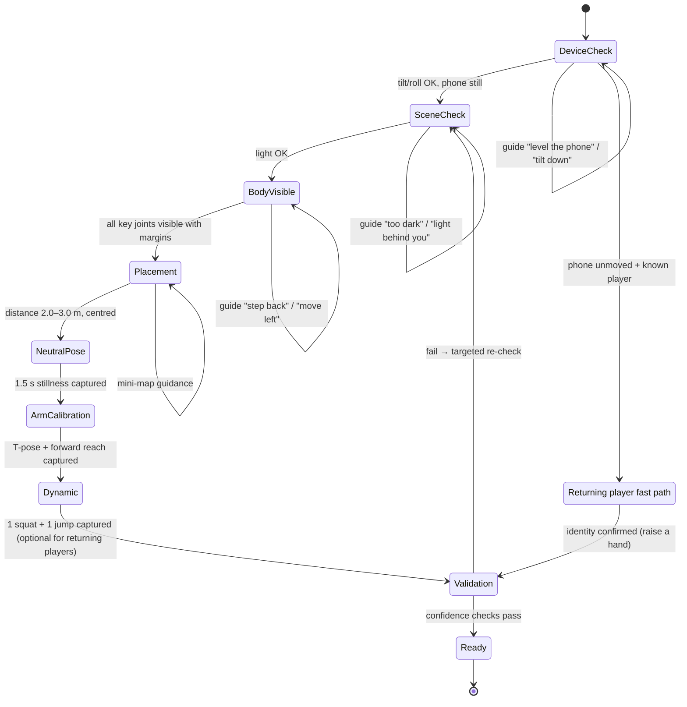

# 04 — Calibration System

Covers deliverable **5** (calibration algorithm design), including whether one calibration profile can be shared across games (it can, and it should be owned by the platform, not by games).

---

## 1. Goals and outputs

Calibration turns "a phone somewhere in a room" into a known, metric sensor, and "a person" into known body proportions. It produces two independent records:

| Record | Scope | Contents | Lifetime |
|---|---|---|---|
| **CameraSetup** | Phone placement in this room | Intrinsics, gravity-aligned tilt, camera height, floor plane, play-area polygon, focus distance, exposure baseline, IMU attitude fingerprint | Valid until the phone moves (detected by IMU) |
| **BodyProfile** | One person | Stature, segment lengths, arm span, standing pelvis height, personal motion thresholds (squat depth, jump height, punch reach), appearance signature | Persistent per person; refined over time |

Because both live on the phone and are summarised to the hub, **every game shares them**. A game never runs its own calibration. It may ask the hub for an *extension* step (for example a range-of-motion check before a dance game), which the hub runs and adds to the BodyProfile.

---

## 2. Flow overview

Target: **≤ 30 s for a first-time player, ≤ 8 s for a returning player with an unmoved phone.**



All guidance is rendered on the **TV** (the phone screen faces away from the player), with a live skeleton overlay, a top-down mini-map, and voice/arrow prompts.

---

## 3. Stages and algorithms

### Stage 1: Camera position and orientation

| Check | Method | Pass condition | Guidance on fail |
|---|---|---|---|
| Stillness | Gyro magnitude and accelerometer variance over 1 s | Gyro < 0.02 rad/s, accel std < 0.05 m/s² | "Place the phone on a tripod or stable surface" |
| Roll | Gravity vector in camera frame (accelerometer, averaged 1 s) | \|roll\| < 3° (corrected in software up to 10°) | "Level the phone" |
| Pitch | Same | −20° ≤ pitch ≤ +5° (slightly downward is ideal) | "Tilt the phone down / up" |
| Orientation | Display rotation + gravity | Landscape | "Turn the phone sideways" |
| Lens | Intrinsics from `CameraCharacteristics` (focal length, principal point, distortion) | Present, or fallback table for this model | — |

The gravity vector gives the rotation **R_gc** from the camera frame to a gravity-aligned frame. This is a *measured* quantity (±0.2–0.5°) and is the foundation of all metric geometry.

### Stage 2: Scene and lighting

| Check | Method | Pass condition |
|---|---|---|
| Exposure headroom | Our AE loop's chosen exposure time and ISO (`SENSOR_EXPOSURE_TIME`, `SENSOR_SENSITIVITY`) | Exposure ≤ 8 ms at ISO ≤ the noise ceiling (tune per device; *estimate* ISO 1600–3200) |
| Person brightness | Mean luma in the person's bounding box | Within mid-tones |
| Backlight | Background luma / person luma | < 3 (else "a bright light or window is behind you") |
| Flicker | Frame-to-frame luma oscillation at 100/120 Hz beat frequencies | If detected, switch to flicker-safe exposures (see [03 §3](03-tracking-technology.md#3-camera-configuration-critical-for-fast-motion)) |

Outcome levels: **Good**, **Usable with warning** (games that need fast punches show a caution), **Too dark** (blocks start; vertical/lateral-only games may still be allowed).

### Stage 3: Full-body visibility

All of nose, shoulders, elbows, wrists, hips, knees, ankles, heels must have visibility ≥ 0.8 for 1 s, and the body's bounding box must keep margins for motion:

- **Top margin** ≥ 0.6 × body height above the head in pixels: room for raised arms (+0.3 H) and jumps (+0.3 m). Computed metrically once Stage 4 has distance.
- **Bottom margin** ≥ 5% of the frame below the toes.
- **Side margins** ≥ arm span / 2 from each side of the body centre (so a T-pose fits).

### Stage 4: Distance, camera height and player height

**Inputs.** User's stature **H** (entered once per BodyProfile; this is the recommended path because it is the cheapest accurate measurement available), plus `R_gc` and intrinsics **K**.

**Geometry.** Work in the gravity-aligned camera frame (y up, camera at the origin, floor at y = −h, h unknown).

1. Foot contact point: midpoint of the heel and toe landmarks of both feet (more accurate than the ankle, which sits ~7–9 cm above the floor). Its pixel defines ray **r_f** = R_gc · K⁻¹ · [u, v, 1]ᵀ, with downward angle α_f below the horizon.
2. Eye point: midpoint of the eye landmarks. Its ray **r_e** makes angle β relative to the horizon (positive above). Standing eye height is anthropometrically E ≈ 0.936 × H (±2 cm).
3. With the player upright at horizontal distance D:
   - tan α_f = h / D
   - tan β = (E − h) / D
   - ⇒ **D = E / (tan α_f + tan β)**, **h = D · tan α_f**
4. Average over ~1.5 s of a still neutral pose (90 frames at 60 fps), reject outliers, and keep h fixed for the session. From then on, root distance comes from floor-plane intersection (needs only h and R_gc) fused with size scaling (see [03 §4](03-tracking-technology.md#4-depth-estimation-approaches)).

**Error budget at D = 2.5 m, h = 1.0 m** (*estimates*): eye-height model ±2 cm and posture ±2 cm → D ±3 cm; landmark noise ±3 px (averaged over 90 frames) → < ±1 cm; pitch error ±0.3° → D ±4 cm. **Total: roughly ±5 cm**, consistent with the ±5–10 cm figure used elsewhere.

**Without stature input:** use the model's metric world-landmark scale as a prior (±5–8% on H, so ±12–20 cm on D at 2.5 m), and ask the user to confirm the estimated height ("Are you about 1.78 m?").

**Placement guidance.** Target zone: D ∈ [2.0, 3.0] m (main lens; [1.6, 2.5] m with ultra-wide), lateral offset |x| < 0.3 m. The TV shows a top-down mini-map with the player's dot and the target zone.

### Stage 5: Neutral pose and body proportions

"Stand still, arms relaxed at your sides" for 1.5 s (stillness: all joint speeds < 5 cm/s).

- Floor plane: confirm h (Stage 4) and set the **Play Space origin** at the floor point between the feet (see [06 §2](06-protocol-and-coordinates.md#2-coordinate-systems)).
- Run the **Heavy** pose model on ~10 sharp frames from this window (latency irrelevant here) for best accuracy.
- Extract, each as a median over frames, rescaled so the skeleton height matches H:
  - shoulder width, hip width, torso length (neck to pelvis)
  - upper arm, forearm, thigh, shin lengths (left and right, then averaged unless asymmetry > 10%)
  - standing pelvis height, standing shoulder height
- Sanity checks against anthropometric ratios (for example thigh ≈ 0.245 H, shin ≈ 0.246 H, upper arm ≈ 0.186 H). Values beyond ±20% indicate a bad detection: repeat.

### Stage 6: Arm extension

1. **T-pose** (arms out to the sides, 1 s): arm span and shoulder-to-wrist length in the image plane, where 2D is most accurate. Cross-check arm span ≈ H.
2. **Forward reach** ("push both hands toward the TV", 1 s): the 2D arm length shrinks to l_min while the true length L is known from step 1, so the true forward reach is √(L² − l_min²). Compare with the model's world-landmark Δz to compute a **personal z-scale correction factor** k_z (learned 3D models tend to under-estimate depth extent). Also stores the player's maximum punch reach, which sets punch thresholds.

### Stage 7: Dynamic samples (first-time players; optional later)

One squat and one jump, prompted on the TV:

| Sample | Extracted |
|---|---|
| Squat | Pelvis drop (m and as % of standing pelvis height), minimum knee angle → personalised squat threshold = 60% of measured drop |
| Jump | Peak pelvis rise, airborne duration, take-off acceleration → personalised jump threshold = 40% of measured rise (with an absolute floor of 8 cm) |

This doubles as a live tracking test: if either sample is not detected cleanly, calibration flags it.

### Stage 8: Play-area boundaries

For each floor point (x, z) in Play Space, the player is "in bounds" if a vertical column from the floor to the player's **reach height** (H × 1.33 + 0.3 m jump margin) at that point, with half the arm span on either side, projects fully inside the frame with margins. Sampling a grid at 10 cm gives a trapezoid (narrow near the camera, wide far away). Then:

- Shrink by 0.2 m for safety and publish it as a polygon in the CameraSetup.
- The TV renders it on the mini-map. Games get `bounds` to keep targets reachable.
- Runtime: an `out_of_bounds` warning fires when the pelvis approaches within 0.2 m of the edge.

The camera cannot reliably see furniture. Physical safety ("clear 1 m around you") is a prompt, not a measurement. One partial signal: if feet visibility drops while the upper body is fine, warn "something may be blocking your feet".

### Stage 9: Tracking-confidence validation

3 s of normal standing and one arm wave:

| Check | Pass |
|---|---|
| Mean visibility of the 13 key joints | ≥ 0.85 |
| Static jitter (after filters) | x/y ≤ 10 mm, z ≤ 30 mm (std) |
| Pose rate | ≥ target (60 or 30) |
| Dropped/late frames on the link | < 2% |
| Round-trip time (ping/pong) | p95 < 50 ms |

On failure, return to the stage that addresses the failing metric with a specific message ("tracking is unstable: try more light", "Wi-Fi is congested: move closer to the router"), never a generic "calibration failed".

---

## 4. Calibration sequence

```mermaid
sequenceDiagram
    autonumber
    actor U as Player
    participant TV as TV hub (guidance UI)
    participant PH as Phone (calibration engine)

    TV->>PH: calibrate {mode: "full" | "quick", playerHint}
    PH->>PH: Stage 1 — IMU tilt/stillness
    PH-->>TV: setup_status {stage: "device", ok: false, hint: "tilt_down"}
    TV-->>U: "Tilt the phone down a little"
    PH-->>TV: setup_status {stage: "device", ok: true}
    PH->>PH: Stage 2 — lighting
    PH->>PH: Stage 3 — full-body visibility
    PH-->>TV: setup_status {stage: "visibility", hint: "step_back", skeleton preview}
    PH->>PH: Stage 4 — solve D and h from stature
    PH-->>TV: setup_status {stage: "placement", player: {x, z}, target_zone}
    TV-->>U: Mini-map: "Step 30 cm back"
    PH-->>TV: setup_status {stage: "pose", prompt: "neutral"} … "t_pose" … "reach" … "squat" … "jump"
    TV-->>U: Animated prompts + countdowns
    PH->>PH: Stage 8 — compute play area; Stage 9 — validate
    PH-->>TV: calibration_done {camera_setup summary, body_metrics, bounds, quality}
    TV-->>U: "Ready!"
```

---

## 5. Profile reuse across sessions and games

| Situation | What runs | Time |
|---|---|---|
| Phone unmoved (IMU attitude within 1°, no shock events), same player | Fast path: identity check (height match ± 5 cm + "raise a hand") → Stage 9 | ~5–8 s |
| Phone moved, known player | Stages 1–4, 8, 9 (body metrics reused) | ~10–15 s |
| New player | Full flow | ~25–30 s |
| Game switch within a session | **Nothing.** Hub keeps the session; next game gets the same profile | 0 s |
| Game needs extra data (for example dance range of motion) | Hub runs that extension stage once, adds it to the BodyProfile | ~5–10 s, once |

**Continuous background refinement** during play: re-estimate floor height whenever both feet are planted and still; update segment lengths with a slow running median; re-check the IMU fingerprint every second. A detected phone move raises `phone_moved`: the game pauses and the hub runs the "phone moved" path.

**Privacy.** Body measurements and appearance signatures are personal data. Keep them on the phone by default, give the user a way to view and delete profiles, and send games only what they need (`BodyMetrics`, not appearance signatures).

### Profile schema (illustrative)

```json
{
  "camera_setup": {
    "version": 1,
    "created_at": "2026-11-12T19:04:11Z",
    "lens": "main",
    "intrinsics": {"fx": 887.1, "fy": 887.1, "cx": 640.0, "cy": 480.0, "w": 1280, "h": 960},
    "distortion": [0.012, -0.031, 0.0, 0.0, 0.0],
    "gravity_tilt_deg": {"pitch": -8.4, "roll": 0.6},
    "camera_height_m": 1.02,
    "focus_distance_m": 2.55,
    "play_area_polygon_m": [[-1.4, 0.6], [1.4, 0.6], [1.0, -0.6], [-1.0, -0.6]],
    "lighting": {"level": "good", "exposure_ms": 4.0, "iso": 1250, "flicker_hz": 0},
    "imu_fingerprint": {"gravity_cam": [0.01, -0.99, -0.146]}
  },
  "body_profile": {
    "id": "p_7f3a",
    "display_name": "Player 1",
    "stature_m": 1.78,
    "source": "user_entered",
    "segments_m": {
      "shoulder_width": 0.40, "hip_width": 0.31, "torso": 0.52,
      "upper_arm": 0.33, "forearm": 0.27, "thigh": 0.44, "shin": 0.44
    },
    "arm_span_m": 1.79,
    "standing_pelvis_height_m": 0.97,
    "z_scale_correction": 1.18,
    "thresholds": {"squat_drop_m": 0.21, "jump_rise_m": 0.12, "punch_reach_m": 0.55},
    "handedness": "right"
  }
}
```
