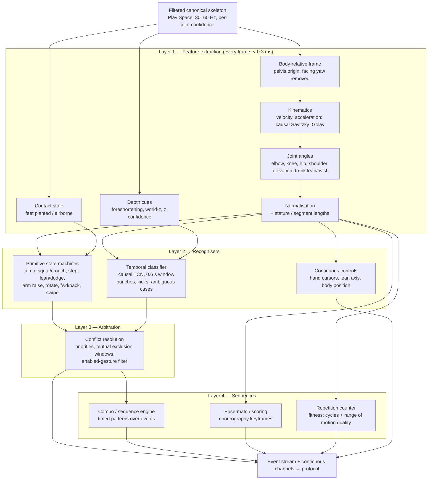

# 05 — Motion Recognition Architecture

Covers deliverable **6**. Recognition uses movement history, velocity, acceleration, joint angles and temporal classification, not static joint positions alone.

---

## 1. Principles

1. **Prefer continuous signals over discrete classification.** Many games need "where is the hand and how fast is it moving", not "a gesture happened". A slice game should test the hand's trajectory against fruit at render time, not wait for a `swipe` event. Continuous control is lower-latency and more robust than any classifier.
2. **Recognise on the phone.** It has the full-rate, unjittered stream and the calibration. The TV receives events with source timestamps. The SDK still exposes raw skeletons so a game can add custom gestures TV-side.
3. **Use the simplest detector that works.** Geometric state machines for gestures that are clear in the image plane (jump, squat, lean, step, raise). A learned temporal model where geometry is ambiguous (punch types, kicks, depth-axis motions).
4. **Fire early, confirm later.** Every event has phases (`start` → `peak` → `end`). Games that need responsiveness act on `start`; games that need certainty act on `confirmed`.
5. **Personalise with calibration.** Thresholds are relative to the player's own measured jump height, squat depth and reach (see [04 §3](04-calibration.md#stage-7-dynamic-samples-first-time-players-optional-later)).
6. **Only enabled gestures run.** Each game declares the gestures it needs. A boxing game that disables `jump` cannot produce a false jump, and the phone saves compute.

---

## 2. Layered architecture



---

## 3. Layer 1: Features

| Feature group | Examples | Notes |
|---|---|---|
| Body-relative positions | Wrist relative to shoulder; ankle relative to pelvis; all in a frame that rotates with the player's facing yaw | Makes "punch forward" mean forward *for the player*, even when turned 30° |
| Global position | Pelvis (x, y, z) in Play Space; height above floor | For steps, jumps, forward/back |
| Kinematics | Velocity and acceleration of wrists, ankles, pelvis, head | Causal Savitzky–Golay derivative (quadratic, 5–7 frames): smooth without centred-window delay |
| Angles | Elbow flexion, knee flexion, hip flexion, shoulder elevation/abduction, trunk lateral lean, trunk twist (shoulder-line vs hip-line yaw) | Angles are invariant to body size and fairly robust to depth error when computed from the 2D view for in-plane joints |
| Normalisation | Divide lengths by stature; divide reach by the calibrated arm length | Same thresholds work for a child and an adult |
| Depth cues | Arm foreshortening ratio l₂D / L; world-landmark Δz × k_z; wrist apparent-size proxy; per-feature z confidence | The key inputs for straight punches and front kicks |
| Contact | Each foot "planted" if heel+toe height < 3 cm and speed < 0.2 m/s | Separates jumps from heel raises, steps from leans |
| Quality | Per-joint visibility, `inferred` flags | The classifier learns to discount blurred/occluded joints |

---

## 4. Layer 2a: Primitive detectors (state machines)

Each detector is a small finite-state machine with hysteresis (separate enter/exit thresholds) and a refractory period. Thresholds below are **starting values** to be tuned on recorded data; *P* values come from the player's BodyProfile.

| Gesture | Enter condition (all must hold) | Exit / end | Phases emitted | Main confusions handled |
|---|---|---|---|---|
| **Jump** | Pelvis upward velocity > 0.8 m/s **and** both feet lose contact **and** pelvis rise > max(0.4 × P.jump_rise, 8 cm) | Both feet planted again | `start` (take-off), `peak` (apex; attributes: height m), `end` (landing) | Heel raise (feet keep toe contact); squat recovery (feet planted) |
| **Squat** | Knee angle < 120° **and** pelvis drop > 0.6 × P.squat_drop | Pelvis back above 0.3 × drop | `start`, `peak` (depth), `end` | Bending forward to pick something up (trunk flexion high, knees straight) |
| **Crouch** (state) | Squat held > 300 ms, **or** pelvis + head drop > 0.25 × stature | Same exit as squat | `crouch_on` / `crouch_off` | — |
| **Side step L/R** | Pelvis lateral displacement > 0.25 m from the settled anchor within 0.6 s, lateral speed > 0.5 m/s, a foot lifts | Pelvis velocity < 0.1 m/s for 200 ms (anchor re-set) | `start`, `end` (attributes: distance) | Lean (feet stay planted) |
| **Lean / dodge L/R** | Trunk lateral lean > 15° **or** head lateral offset vs pelvis > 0.15 m; both feet planted. `dodge` if lean angular speed > 90°/s | Lean < 8° | `start`, `peak`, `end` | Side step |
| **Arm raise** (L/R/both) | Wrist above head top by > 0.10 m for > 200 ms | Wrist below shoulder | `start`, `end` | Uppercut (fast, short; classifier wins) |
| **Body rotation** | Shoulder-line yaw change > 30° from facing reference | Return within 15° | `start`, `peak` (degrees) | Trunk twist vs whole-body turn (feet yaw distinguishes them) |
| **Forward / back move** | Pelvis z change > 0.25 m from anchor within 1 s | Settled | `start`, `end` (distance) | Lean forward (feet planted) |
| **Swipe** (4/8 dir) | Wrist speed in body-relative image plane > 2 m/s for ≥ 120 ms, path length > 0.3 m | Speed < 0.8 m/s | `start`, `end` (direction vector, speed) | Punch (depth component, classifier) |
| **Hand cursor** (continuous) | Hand inside the Physical Interaction Zone (box in front of the shoulder) | Hand dropped below hip for > 0.5 s | Continuous `cursor` channel; `hover`/`press` via dwell time | — |

---

## 5. Layer 2b: Temporal classifier

### Scope

Gestures that geometry cannot separate reliably:

- Punches: `jab_l/r`, `cross_l/r`, `hook_l/r`, `uppercut_l/r` (games can collapse these to `punch_l/r`)
- Kicks: `front_kick_l/r`, `side_kick_l/r`, `knee_raise_l/r`
- A **null class** trained on lots of non-gesture movement: the single biggest lever on false positives

It also serves as a second opinion for primitive detectors in ambiguous cases (uppercut vs arm raise, front kick vs knee raise).

### Model

| Aspect | Choice |
|---|---|
| Architecture | Causal temporal convolutional network (dilated 1D convs; receptive field ~0.6 s = 36 frames at 60 Hz), or a 1-layer GRU. Both are streaming: one step per new frame |
| Input | ~80–120 features per frame from Layer 1, incl. confidence flags |
| Output | Per-frame class probabilities + an "onset" head trained to fire at the start of the motion |
| Size / cost | 50–200 k parameters, < 0.5 ms per frame on CPU (LiteRT) |
| Decision rule | Fire `start` when P(class) > θ_start for 2 consecutive frames; `confirmed` when P > θ_conf or at the peak; refractory period per limb ~250 ms |
| Target latency | `start` within ~60–100 ms of motion onset, which is around peak wrist velocity of a punch (*estimate*; measured in the benchmark) |

### Training data

- Source: the Phase 0/1 recorder (raw video + IMU) on the S23 Ultra, run through the chosen pose backend so the classifier learns *that backend's* noise and failure modes.
- Volume target for the MVP gesture set: **≥ 40 people × 20 reps × each class × 3 lighting levels**, plus ≥ 2 h of null-class footage (natural movement, games of other types, idle).
- Labels: onset / peak / end per gesture, done in an annotation tool over the video, with the skeleton overlaid.
- Augmentation: left/right mirroring (with label swap), time warping (0.7–1.4× speed), joint dropout and confidence lowering (simulating blur/occlusion), small 3D rotations of the skeleton (simulating camera placement), noise matched to measured jitter.
- Split by person, never by clip, so the score reflects unseen players.

---

## 6. Layer 3: Arbitration

| Conflict | Rule |
|---|---|
| Jump vs squat recovery | Jump requires both feet airborne; squat suppresses jump for 150 ms after its `end` unless airborne |
| Side step vs lean | Feet planted → lean; foot lift + pelvis displacement → step |
| Punch vs arm raise vs swipe | Classifier result has priority within its window; primitive `arm_raise` waits 200 ms of hold, which a punch never satisfies |
| Same limb, two events | One active event per limb at a time; refractory period |
| Gesture not enabled by the game | Suppressed at the source, and the corresponding model head is skipped |
| Low tracking confidence | Events from joints in `inferred` state carry a confidence penalty; below a floor they are dropped and a `tracking_degraded` signal is sent instead |

---

## 7. Layer 4: Sequences and scoring

| Engine | Use | Method |
|---|---|---|
| **Combo engine** | "jab, jab, cross within 1.2 s"; "jump then crouch" | Declarative patterns (event IDs + max gaps) compiled to finite automata; matched over the event stream. Games register patterns at runtime |
| **Pose-match scorer** | Dance and fitness form | Reference choreography = keyframes of joint *angles* (not positions) with timestamps. Per keyframe, score similarity within a ±150 ms window using weighted angle distances (weights per body part per move). Angles make it body-size-independent and robust to depth error. Report `perfect/good/ok/miss` |
| **Repetition counter** | Squats, jumping jacks, lunges | Cyclic state machine on one primary angle (for example knee angle) with range-of-motion quality = achieved range / calibrated range; tempo from cycle timing |

Offline tools (not real-time) can use dynamic time warping to author choreography from a recorded reference dancer.

---

## 8. Event model (summary)

Full wire format in [06 §5](06-protocol-and-coordinates.md#5-message-catalogue).

```json
{
  "type": "gesture",
  "id": "punch_r",
  "subtype": "cross",
  "phase": "start",
  "player_id": 1,
  "event_seq": 4812,
  "t_source_us": 1731438251123456,
  "confidence": 0.91,
  "attributes": {"speed_mps": 6.8, "direction": [0.05, 0.02, -0.99], "reach_ratio": 0.86}
}
```

- `t_source_us` is the capture time of the frame where the phase was detected (shared clock). Games can measure their own reaction latency and compensate (for example rhythm games judge timing against the source time, not the arrival time).
- `direction` is in Play Space (−z = toward the TV/camera).
- Every `start` is followed by an `end` or a `cancel`, so games can safely build state on `start`.

---

## 9. Quality process

- **Regression suite:** every recorded and labelled clip becomes a test case. Each change to filters, thresholds or models reports per-gesture precision/recall/latency deltas, and CI blocks regressions above a tolerance.
- **Shared recogniser for the Kinect benchmark:** Layers 1–4 accept the canonical skeleton from any source, so the same code can run on Kinect v1 recordings (see [01 §4.5](01-feasibility-and-kinect-comparison.md#45-metrics)).
- **Field telemetry (opt-in):** anonymous counts of events, cancels and "player repeated the motion within 1 s" (a proxy for a missed detection). No video or skeleton data leaves the device without explicit consent.
