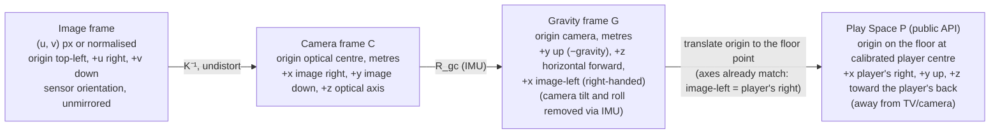

# 06 — Communication Protocol and Coordinate System

Covers deliverables **7** (communication protocol) and **8** (coordinate system specification). Protocol name: **MotionHub Sensor Protocol (MSP) v1**.

---

## 1. Transport evaluation

| Transport | Available to a Tizen web app? | Latency on a good LAN | Loss behaviour | Complexity | Verdict |
|---|---|---|---|---|---|
| **WebSocket (binary) over TCP** | **Yes** (client side) | 1–5 ms typical | Reliable and ordered: one lost packet delays later frames (head-of-line blocking) until retransmit | Low | **MVP choice** |
| Raw UDP | **No** for web apps | Lowest | Lossy, no head-of-line blocking | Medium | Use later on Android TV (native shell), behind the same transport interface |
| WebRTC data channel (unordered, `maxRetransmits: 0`) | Depends on Tizen engine version: **verify per model year** | Near UDP | Lossy mode available for frames, reliable mode for events | High: ICE, DTLS, signalling, mDNS host-candidate quirks | **Upgrade path** if Phase 0 shows TCP jitter spikes matter |
| WebTransport / QUIC | No (TV engines too old) | — | — | — | Not viable |
| HTTP polling, SSE, MQTT | Yes | Tens of ms+ | — | Low | Too slow / unnecessary |
| Samsung Multiscreen / Smart View channel | Legacy SDK, status uncertain | — | — | — | Do not depend on it |
| Bluetooth LE | No BLE API for TV web apps | 7.5–30 ms connection intervals | — | — | Not viable |

**Why TCP is acceptable for the MVP.** The stream is ~15 KB/s of tiny messages on a LAN where loss is rare. With `TCP_NODELAY` and 60 messages/s, a lost segment is usually recovered by fast retransmit within a few tens of milliseconds. The receiver uses only the newest frame, so a short stall shows up as one late frame, not cumulative lag. This is a hypothesis; the Phase 0 network test measures p95/p99 latency on real home Wi-Fi to confirm it.

**Wi-Fi settings that matter more than protocol choice:**

- Phone: hold a `WifiManager.WifiLock` in `WIFI_MODE_FULL_LOW_LATENCY` (Android 10+) while streaming. Wi-Fi power-save otherwise adds 50–200 ms of bursty delay.
- Recommend 5 GHz (or 6 GHz) Wi-Fi, and Ethernet for the TV where possible.
- Detect client isolation (guest networks) during pairing and explain it.

### Roles

**Phone = WebSocket server, TV = client** (Tizen web apps can't listen). Discovery is covered in [02 §6.1](02-architecture.md#61-pairing-and-session-start). Default port 47800, falling back to 47801–47809. Path `/msp/v1`.

---

## 2. Coordinate systems

All spatial data on the wire uses **Play Space**. The other frames are internal to the phone and listed so the transform chain is unambiguous.

### Play Space specification (normative)

| Property | Value |
|---|---|
| Handedness | Right-handed |
| Units | Metres (positions), seconds (time), radians internally / degrees in UI-oriented fields as named (`*_deg`) |
| Origin | On the floor, at the midpoint between the player's feet during the neutral-pose calibration |
| +Y | Up, opposite to gravity (measured by the phone accelerometer) |
| +X | To the **player's right** when the player faces the camera/TV. On screen, this is the screen's right as seen by the player |
| +Z | From the camera/TV toward the player and beyond (away from the screen). **Moving toward the TV decreases z.** |
| Assumption | The camera is placed at the TV, roughly facing the player. If the phone is offset from the TV, X/Z are still relative to the *camera*; the hub may store an optional camera-to-screen yaw offset |
| Why this convention | It equals the default WebGL/Three.js view convention (x right, y up, z toward the viewer), so a game can render a **mirror avatar** without converting coordinates |
| Joint sides | Anatomical: `left_wrist` is the player's own left wrist (appears on the screen's left in mirror view, since +x is the player's right) |
| Facing yaw | 0° = facing the camera; positive = turning to the player's left (counter-clockwise viewed from above, right-hand rule about +y) |

**2D screen mapping for UI.** Hand cursors are delivered separately as normalised `[0,1]²` screen coordinates (origin top-left, mirrored so moving the right hand right moves the cursor right). They are computed from a **Physical Interaction Zone**, a box anchored at the shoulder and sized by the calibrated arm length, so cursor reach is the same for every player at any distance.

---

## 3. Canonical skeleton

25 joints, model-independent. Backends map their native points to these; derived joints are computed on the phone.

| Idx | Joint | MediaPipe source (33-point index) |
|---|---|---|
| 0 | `pelvis` | derived: midpoint of 23, 24 |
| 1 | `spine_mid` | derived: midpoint of pelvis and neck |
| 2 | `neck` | derived: midpoint of 11, 12 |
| 3 | `head` | derived: midpoint of 7, 8 (ears) |
| 4 | `nose` | 0 |
| 5 | `left_shoulder` | 11 |
| 6 | `left_elbow` | 13 |
| 7 | `left_wrist` | 15 |
| 8 | `left_hand` | derived: centroid of 17, 19 (pinky and index knuckles) |
| 9 | `right_shoulder` | 12 |
| 10 | `right_elbow` | 14 |
| 11 | `right_wrist` | 16 |
| 12 | `right_hand` | derived: centroid of 18, 20 |
| 13 | `left_hip` | 23 |
| 14 | `left_knee` | 25 |
| 15 | `left_ankle` | 27 |
| 16 | `left_heel` | 29 |
| 17 | `left_toe` | 31 |
| 18 | `right_hip` | 24 |
| 19 | `right_knee` | 26 |
| 20 | `right_ankle` | 28 |
| 21 | `right_heel` | 30 |
| 22 | `right_toe` | 32 |
| 23 | `left_eye` | 2 |
| 24 | `right_eye` | 5 |

Per-joint state: `tracked` (directly observed), `inferred` (predicted or low-visibility, like Kinect's *Inferred*), `lost` (position held, should be ignored).

---

## 4. Message framing

One WebSocket connection carries two kinds of messages, in order:

| Kind | WebSocket frame | Encoding | Rate | Why |
|---|---|---|---|---|
| Tracking frames | Binary | Fixed little-endian layout (§4.1) | 30–60 Hz | Compact (~236 B/player), zero-parse-cost typed-array decoding on the TV, no GC churn |
| Events and control | Text | JSON (§5) | Low (< 20/s) | Debuggable, extensible; size is irrelevant at this rate |

Both kinds share the phone's clock domain for timestamps (§6).

### 4.1 `TrackingFrame` binary layout (v1)

**Header: 24 bytes**

| Offset | Field | Type | Notes |
|---|---|---|---|
| 0 | `msg_type` | u8 | `0x01` |
| 1 | `version` | u8 | `1` |
| 2 | `flags` | u16 | bit0 `predicted` (joints extrapolated), bit1 `degraded` (thermal or low light), bit2 `calibrating` |
| 4 | `frame_seq` | u32 | Monotonic; gaps = dropped frames |
| 8 | `t_capture_us` | u64 | Sensor exposure time, phone clock, µs |
| 16 | `send_delay_us` | u32 | Capture → send on the phone (pipeline latency, for telemetry) |
| 20 | `player_count` | u8 | 0–4 |
| 21 | `joint_count` | u8 | 25 in v1. Lets later versions add joints without breaking old readers |
| 22 | `reserved` | u16 | 0 |

**Per player: 20 + 8 × joint_count bytes (220 B for 25 joints) in v2; 12 + 8 × joint_count in v1**

v2 (`version` = 2, added 2026-11-12) appends head orientation to the player header. Receivers must accept both versions; v1 frames simply have no head data.

| Offset | Field | Type | Notes |
|---|---|---|---|
| 0 | `player_id` | u8 | Stable for the session |
| 1 | `tracking_state` | u8 | 0 lost, 1 inferred, 2 tracked |
| 2 | `confidence` | u8 | 0–255 → 0.0–1.0 |
| 3 | `z_confidence` | u8 | Separate depth confidence |
| 4 | `facing_yaw` | i16 | 0.01° units |
| 6 | `root_x/y/z` | i16 ×3 | Pelvis floor projection, mm, Play Space |
| 12 | `head_yaw` | i16 | v2: 0.01° units; 0 = facing the camera, + = turned toward the player's left |
| 14 | `head_pitch` | i16 | v2: 0.01° units; + = looking up, relative to the neutral pitch captured at calibration |
| 16 | `head_roll` | i16 | v2: 0.01° units; + = tilted toward the player's left shoulder |
| 18 | `head_confidence` | u8 | v2: 0 = no head estimate (face not visible) |
| 19 | `reserved` | u8 | v2: 0 |

**Per joint: 8 bytes**

| Offset | Field | Type | Notes |
|---|---|---|---|
| 0 | `x, y, z` | i16 ×3 | mm, Play Space (±32.7 m range, 1 mm resolution, far below sensor precision) |
| 6 | `confidence` | u8 | 0–255 |
| 7 | `state` | u8 | bits 0–1: 0 lost / 1 inferred / 2 tracked; bits 2–7 reserved |

**Bandwidth:** 24 + 220 = 244 B per frame for one player (v2). At 60 Hz ≈ 14 KB/s (~0.11 Mbit/s); with TCP/IP/WebSocket overhead ≈ 18 KB/s. Two players ≈ 31 KB/s. Negligible on any Wi-Fi.

Joints are absolute in Play Space (not relative to the root) so a game can use any joint without reconstructing a hierarchy.

---

## 5. Message catalogue

JSON messages share an envelope: `{"type": "...", "seq": <u32>, "t_us": <phone-clock µs, where applicable>, ...}`. Unknown fields must be ignored; unknown `type`s must be ignored and logged.

### Session and pairing

| Type | Direction | Payload (main fields) |
|---|---|---|
| `hello` | TV → phone | `token`, `hub_version`, `protocols: ["msp/1"]`, `platform` (tizen/androidtv), `tv_name` |
| `welcome` | phone → TV | `session_id`, `resume_key`, `sensor_version`, `capabilities` (max_fps, max_players, backends, gestures supported), `device_model` |
| `resume` | TV → phone | `session_id`, `resume_key` (after reconnect) |
| `ping` / `pong` | TV ↔ phone | `t0`; reply adds `t1` (phone receive), `t2` (phone send) |
| `bye` | either | `reason` |
| `error` | either | `code`, `message`, `recoverable` |

### Setup and calibration

| Type | Direction | Payload |
|---|---|---|
| `calibrate` | TV → phone | `mode`: full / quick / extension, `extension_id` |
| `setup_status` | phone → TV | `stage`, `ok`, `hint` (machine-readable code: `tilt_down`, `step_back`, `too_dark`, `backlight`, …), `progress`, live `player_pos`, `target_zone` |
| `calibration_done` | phone → TV | `camera_setup` summary (bounds polygon, lighting level), `players[]` with `body_metrics`, `quality` |

### Game session

| Type | Direction | Payload |
|---|---|---|
| `game_start` | TV → phone | `game_id`, `gestures[]` to enable, `max_players`, `stream`: `{fps: 60, predict_ms: 0, cursor: true}` |
| `game_pause` / `game_resume` / `game_end` | TV → phone | `reason` |
| `stream_config` | TV → phone | Change rate/prediction/gesture set mid-game |

### Events (phone → TV)

| Type | Payload |
|---|---|
| `gesture` | `id`, `subtype`, `phase` (start / peak / end / cancel / confirmed), `player_id`, `event_seq`, `t_source_us`, `confidence`, `attributes` (see [05 §8](05-motion-recognition.md#8-event-model-summary)) |
| `cursor` | Optional JSON fallback; normally carried in a binary `CursorFrame` (`msg_type 0x02`: player_id, hand, u, v, `pressing`, dwell progress) |
| `player` | `event`: joined / left / lost / reacquired / identified, `player_id`, `profile_id` |
| `sensor` | `event`: paused / resumed / phone_moved / lighting_changed / thermal_degraded / battery_low / out_of_bounds, `detail` |

---

## 6. Timing and clock synchronisation

- **Phone clock:** `SystemClock.elapsedRealtimeNanos()`; camera `SENSOR_TIMESTAMP` is in the same base when the camera reports a REALTIME timestamp source (verify on the S23 Ultra).
- **Offset estimation** (NTP-style, every 2 s, plus a burst of 10 at connect). With TV send time t0, phone receive t1, phone send t2 and TV receive t3:
  - `offset = ((t1 − t0) + (t2 − t3)) / 2`
  - `rtt = (t3 − t0) − (t2 − t1)`
  - Keep the samples with the lowest RTT in a 30-sample window and fit offset + drift by linear regression. Expected precision on a LAN: ~1–2 ms.
- **TV use:** `tv_time = t_capture_us + offset` for every frame and event. That gives:
  - per-frame *capture → TV receive* latency (live telemetry),
  - jitter-free sampling in `skeletonAt(renderTime)`: frames are placed on the capture timeline, then either the latest is taken (`latest` mode, lowest latency) or the two frames bracketing `renderTime − bufferDelay` are interpolated (`interpolated` mode, smoothest; `bufferDelay` adapts to measured jitter, typically 8–20 ms).

---

## 7. Reliability and session management

| Concern | Mechanism |
|---|---|
| Liveness | TV expects a frame or `pong` at least every 500 ms. No data for 500 ms → `sensor: paused` emitted locally to games. 3 s → reconnect |
| Reconnect | TV retries the last address with backoff 250 ms → 4 s, sends `resume` with `resume_key`; phone restores session, calibration and the active game's gesture set |
| Phone IP change | TV re-runs discovery (subnet probe / rendezvous) using the stored pairing secret, so no QR rescan |
| Back-pressure | Phone keeps a single-slot outbound queue for frames (latest wins); events and control messages are never dropped |
| Ordering | Guaranteed by TCP. With a future lossy transport, frames carry `frame_seq` and events carry `event_seq` for gap detection |
| Versioning | `version` byte in binary frames; `protocols` negotiation in `hello`/`welcome`; additive changes only within a major version |
| Multiple games | Protocol is game-agnostic. Games differ only in their `game_start` gesture set and stream options |
| Multiple sensors (future) | `sensor_id` in `welcome` allows two phones (two players, or a side view for depth) without a new protocol |

### Security (pragmatic, LAN-only)

- Pairing token: 128-bit random, single use, 5-minute lifetime, shown only in the QR code. Connections without a valid token or resume key are closed immediately.
- After pairing, both sides store a per-pair secret used to authenticate reconnections (HMAC challenge in `hello`/`resume`).
- No TLS on the LAN in v1: TV web engines handle self-signed certificates poorly. Payloads contain skeletons, never images. Revisit if any personal data beyond body metrics ever crosses the link.
- Rate-limit connection attempts on the phone (the subnet probe makes many attempts by design).
