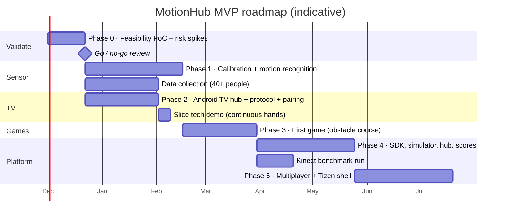

# 08 — MVP Roadmap, Game Fit and Technical Risks

Covers deliverables **11** (MVP roadmap) and **12** (main technical risks), plus how the initial game concepts fit the sensor's strengths.

---

## 1. Game concepts vs sensor strengths

Choose the first games by what the sensor does best, not by what Kinect was famous for.

| Concept | Primary inputs | Fit with phone tracking | Design notes |
|---|---|---|---|
| **Slice game** (cut flying objects) | Continuous hand trajectories in the image plane | **Excellent** | No classifier needed: the game intersects hand paths (sampled at render time, with velocity) with objects. Strong first-impression demo |
| **Obstacle course** | Jump, crouch, lean/dodge, side step | **Excellent** | Uses the most reliable gestures. Best first *event-driven* game |
| **Fitness** | Rep counting, range of motion, holds | Good | Depth-dependent form cues (knee over toes, forward lean) are limited; favour side-view-independent cues |
| **Dance** | Pose matching on joint angles + timing | Good | Choreography should favour moves readable from the front; score angles, not positions |
| **Sports: tennis / baseball / bowling** | Lateral arm swings, timing, body rotation | Good | Swings are mostly lateral, so they read well |
| **Sports: football kick** | Front kick toward the camera | Weak | Use side-on approach, or score knee lift + timing instead of kick depth |
| **Boxing** | Punches, dodges, blocks | **Medium** | Make targets appear at different heights and sides so hooks/uppercuts and left/right decide the outcome. Treat jab vs cross as cosmetic until the classifier proves otherwise |
| **Party / multiplayer** | Varies | Weak until Phase 5 | Start with turn-based "pass the phone's view" party games; 2 players side by side later |

---

## 2. Phased plan

The brief's five phases are kept, with a measurement-first **Phase 0** in front, and the brief's Phase 1 folded into it. Durations assume a core team of: 1 Android/CV engineer, 1 ML engineer (from Phase 1), 1 TV/web engineer (from Phase 0 week 3), 1 game developer (from Phase 3), part-time QA/data collection and a designer.

### Phase 0: Feasibility PoC and risk spikes (3 weeks)

Goal: answer the top five risks with numbers (README §2–3).

| Work | Output |
|---|---|
| Android app: CameraX 1280×960 @ 60, own exposure control, MediaPipe Pose (Full, GPU), skeleton overlay, FPS/latency HUD | APK + measurements |
| **Recorder**: raw video + IMU + camera metadata to files; labelling of a first 10-person dataset | Reusable dataset (grows in Phase 1) |
| Offline bake-off: MediaPipe vs RTMPose on the recordings; simple rule-based jump/squat/side-step/punch detectors | Per-gesture P/R per lighting level; model decision input |
| Distance estimation vs tape marks | Error table at 2.0/2.5/3.0 m |
| 45-minute thermal soak | FPS/headroom/battery curves |
| TV receiver (shared TypeScript) in an Android TV WebView shell; NSD discovery of the phone; skeleton drawn at 60 Hz; per-frame timing reported back to the phone | Pairing success on 2–3 home routers + network latency distribution |
| Photon-to-photon (240 fps camera) on 2 TV model years | Display-path latency numbers |

**Exit:** go/no-go criteria in [README §3](README.md#3-recommended-first-step-a-3-week-proof-of-concept).

### Phase 1: Calibration and motion recognition (8 weeks)

| Work | Exit criteria |
|---|---|
| Full calibration flow (Stages 1–9), profile store, fast path, phone-moved detection | First-attempt success ≥ 90%, ≤ 45 s, across 10 rooms |
| Root-depth fusion, bone-length constraints, filters, occlusion states | Static jitter ≤ 10 mm x/y, ≤ 30 mm z |
| Primitive detectors: jump, squat/crouch, side step, lean/dodge, arm raise, swipe, forward/back | F1 ≥ 0.95 on held-out people |
| Data collection to ≥ 40 people; labelling tool | Dataset with person-level splits |
| Temporal classifier v1 (punches, kicks, null class) | Punch F1 ≥ 0.90; straight punch ≥ 0.80 |
| Regression suite over recorded clips, run in CI | Per-gesture report on every change |
| Thermal ladder | 45-min soak passes |

### Phase 2: TV communication and hub foundation on Android TV (6 weeks, parallel to Phase 1)

| Work | Exit criteria |
|---|---|
| Android TV shell (WebView + NSD + JS bridge), PlatformAdapter, remote-key navigation | Runs on 2 Android TV / Google TV devices (one low-end, e.g. a 2020-era TV SoC) |
| NSD pairing with QR to pick the phone; reconnection with resume | Pairs in ≤ 10 s on 5 different home networks; recovers from Wi-Fi drop without re-calibration |
| MSP v1 codecs (Kotlin + TS) from one schema, golden test vectors | Byte-identical round trips |
| Clock sync, jitter buffer, `skeletonAt()` | Capture → TV receive p50 ≤ 60 ms, p95 ≤ 100 ms |
| Calibration UI on TV (guidance, mini-map, prompts) | Usability test with 5 first-time users |
| Skeleton/avatar visualiser + debug HUD | — |
| One-week **slice tech demo** (continuous hand tracking only) | Fun, responsive demo for stakeholders |

### Phase 3: First game (6 weeks)

**Recommendation: obstacle course** (jump, crouch, dodge, side step): the most reliable gestures, and it exercises the full event pipeline. The slice demo from Phase 2 can be polished into the second title.

| Exit criteria |
|---|
| 10-minute sessions playable by first-time players without help |
| ≤ 1 perceived "it didn't register" per 5 minutes (measured by observation + telemetry proxy) |
| Stable 60 fps rendering on the oldest supported TV model |

### Phase 4: Reusable platform (8 weeks)

| Work |
|---|
| Motion SDK (TypeScript) with typed API, gesture enable/disable, cursors, `skeletonAt()` modes |
| Simulator: keyboard/mouse/gamepad + replay of recorded sessions (`.mhrec`); games testable in a desktop browser |
| Game catalogue, lazy loading, lifecycle contract, pause/resume on sensor events |
| Player profiles and scores (local); gesture-operable menus |
| Combo/sequence engine and pose-match scorer exposed to games |
| **Kinect v1 benchmark** run and published internally (see [01 §4](01-feasibility-and-kinect-comparison.md#4-benchmark-protocol)) |

### Phase 5: Multiplayer and second platform (8 weeks, after MVP)

| Work |
|---|
| 2-player tracking: backend re-evaluation (MediaPipe `numPoses=2` vs RTMPose + tracker vs RTMO vs licensed YOLO-pose), identity tracking, per-player calibration |
| Samsung Tizen shell: package the same hub as `.wgt`; subnet-probe / rendezvous pairing; Tizen latency and engine checks (A5–A8) |
| Boxing and dance titles designed around measured capabilities |
| Optional: fine-tune the pose model on the collected motion-blur-heavy dataset |

---

## 3. Risk register

Likelihood (L) and impact (I): H/M/L.

| ID | Risk | L | I | Mitigation | Retired / tracked in |
|---|---|---|---|---|---|
| R1 | **Motion blur and lighting:** wrists lost on fast punches/kicks at normal indoor light | H | H | Own exposure control (≤ 4–8 ms), 60 fps, lighting check in calibration, classifier robust to dropped joints, blur-augmented fine-tuning later; game design favours robust gestures | Phase 0 dataset; Phase 1 classifier |
| R2 | **TV display-path latency** of the Android TV WebView (and later the Tizen graphics plane) is high or varies by model/picture mode | M | H | Measure on several model years; Game Mode guidance; prediction and anticipatory animation; adjust supported-model list | Phase 0 photon test |
| R3 | **Tizen networking limits** (second platform): no listening sockets, no WebRTC on older engines | H (for listening) | M | Phone-as-server design (already used on Android TV); subnet probe + rendezvous fallback; transport abstraction | Phase 5 Tizen spike |
| R4 | **Depth-axis gestures** (straight punch, front kick, small forward steps) below target | H | M | Foreshortening + learned z features, personal z-scale calibration, game design that does not depend on them | Phase 0/1 metrics |
| R5 | **Thermal throttling** in sessions > 30 min | M | M | Thermal ladder, NPU offload, dimmed screen, pause-USB-PD investigation | Phase 0 soak |
| R6 | **Home network diversity:** client isolation, mesh, multiple subnets, congested 2.4 GHz | M | M | Clear diagnostics, rendezvous fallback, Wi-Fi low-latency lock, 5 GHz guidance | Phase 2 field test (5+ networks) |
| R7 | **Old TV browser engines:** missing WebGL 2 / ES features, weak GPUs, GC pauses | M | M | 2020+ baseline, ES2017 target, WebGL 1-compatible renderers, profiling on oldest model | Phase 2 |
| R8 | **Camera control availability on Samsung:** 4:3 @ 60 fps, manual exposure, REALTIME timestamps, EIS off may not all be honoured | M | M | Verify early; fall back to 16:9 + ultra-wide, AE with 60 fps cap | Phase 0 week 1 |
| R9 | **MediaPipe constraints:** hidden smoothing, ROI-tracker loss on fast motion, API changes | M | M | `PoseBackend` abstraction; RTMPose challenger kept alive | Phase 0 bake-off |
| R10 | **Multiplayer identity swaps** when players cross | H | M | Defer to Phase 5; design party games around side-by-side play | Phase 5 |
| R11 | **Dataset bias:** recognisers work worse for under-represented body types, skin tones, clothing, children | M | H | Diverse recruitment targets, per-group metrics in the regression report | Phase 1 onward |
| R12 | **Setup friction:** rooms too small, no tripod, phone placed badly | H | M | Ultra-wide fallback, strong TV guidance, accessory recommendation (tripod + cable) | Phase 2–3 usability tests |
| R13 | **Store certification** (Samsung Seller Office review, performance/UX rules) | M | M | Read requirements early; test on certification checklists before Phase 3 ends | Phase 3 |
| R14 | **IP / trademark:** "Kinect" naming, clones of existing games | L | H | Original names and game designs; no third-party assets | Ongoing |
| R15 | **Privacy perception:** a camera app in the living room | M | M | No video leaves the phone (architectural guarantee), local-only profiles, clear permission copy, opt-in telemetry without video | Ongoing |
| R16 | **Phone interruptions** (calls, notifications, OS killing the camera) | M | L | Explicit `sensor: paused`, fast resume without re-calibration, Do Not Disturb suggestion during play | Phase 1–2 |

---

## 4. Assumptions to verify in Phase 0

Each of these is used somewhere in the design and none has been measured yet:

| # | Assumption | Used in |
|---|---|---|
| A1 | S23 Ultra delivers a 1280×960 (4:3) `ImageAnalysis` stream at a fixed 60 fps | [03 §3](03-tracking-technology.md#3-camera-configuration-critical-for-fast-motion), FOV analysis |
| A2 | Manual exposure / ISO and EIS-off requests are honoured; `SENSOR_TIMESTAMP` uses the REALTIME base | Exposure control, latency measurement |
| A3 | MediaPipe Pose Full runs ≤ 15 ms on GPU while the camera streams at 60 fps | Latency budget |
| A4 | MediaPipe's internal smoothing lag is small or can be compensated | Filtering |
| A5 | (Tizen, later) Tizen web apps cannot listen on sockets (or: a service app can) | Pairing strategy A vs B |
| A6 | (Tizen, later) WebRTC data channels availability per Tizen model year | Transport upgrade path |
| A7 | WebGL 2 availability per model year | Three.js version pinning |
| A8 | Android TV WebView display latency (and later Tizen's graphics plane), and whether Game Mode changes it | Motion-to-photon budget |
| A9 | Wi-Fi low-latency lock removes power-save spikes on the S23 Ultra | Network budget |
| A10 | Samsung "pause USB power delivery" is usable by this app | Thermal plan |
| A11 | Floor-plane distance error ≤ 10 cm at 2–3 m in real rooms | Calibration, depth claims |
